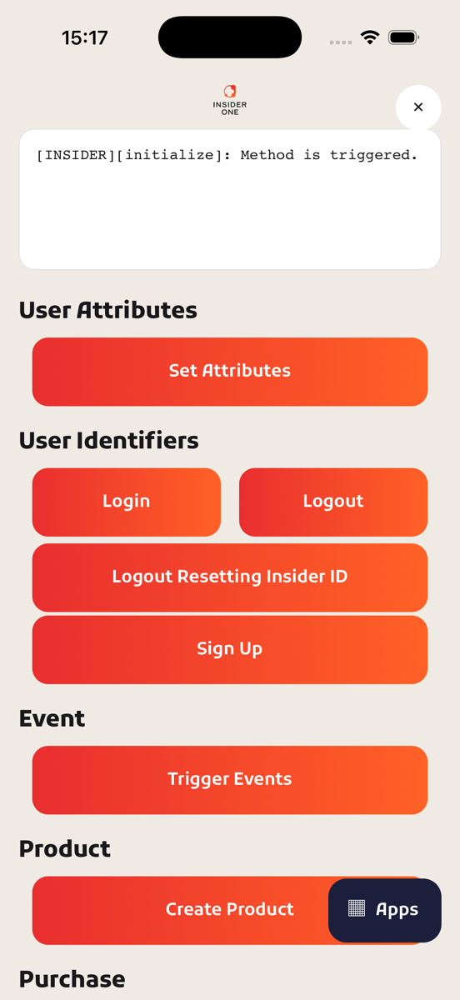
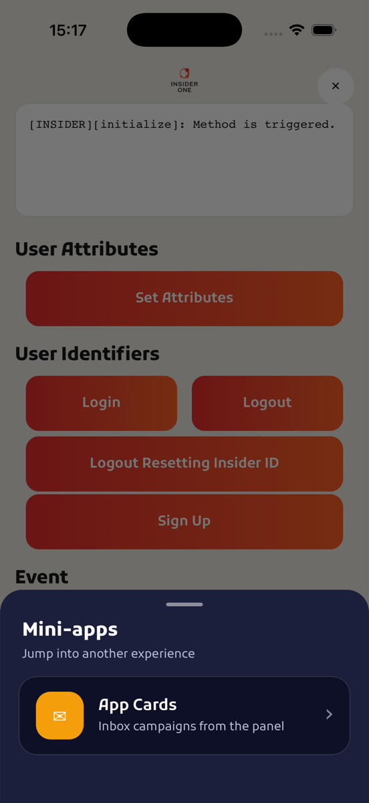
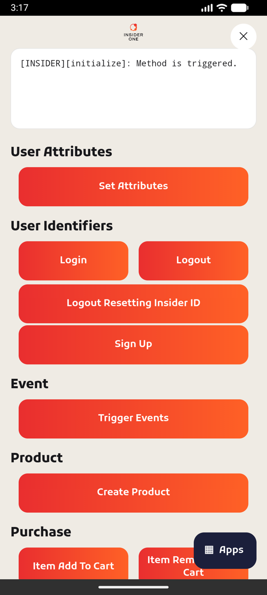
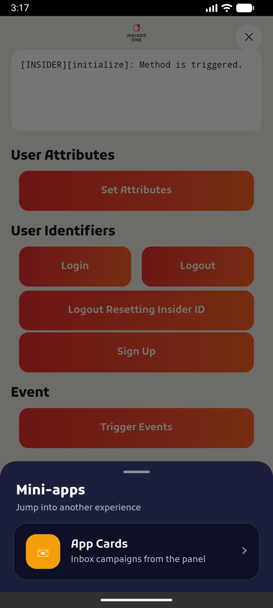

# Insider Cordova Demo

  

  <table align="center">
    <tr>
      <td><a href="https://useinsider.com/"> Insider </a></td>
      <td><a href="https://www.npmjs.com/package/cordova-plugin-insider/"> NPM JS cordova-plugin-insider </a></td>
      <td><a href="https://academy.useinsider.com/docs/cordova-integration"> InsiderAcademy </a></td>
    </tr>
  </table>

  

## Description

This Demo contains simple methods that you can use with the Insider SDK. The home page follows the shared Insider demo design (FlutterDemo):

- an output console under the logo bar: every button writes the SDK call's result (or error) there, so you can check a call without Xcode or logcat; the round button in the logo bar clears it,
- one section per SDK area (user, events, products, purchase, Smart Recommender, page visits, GDPR, App Cards, Content Optimizer, geofence, in-app messages, wishlist, reinit and more),
- an **Apps** button that opens the mini-apps sheet; **App Cards** opens the App Cards inbox page.

## Preview

<table align="center">
  <tr>
    <th colspan="2">iOS</th>
    <th colspan="2">Android</th>
  </tr>
  <tr>
    <td></td>
    <td></td>
    <td></td>
    <td></td>
  </tr>
</table>

## Requirements

- Node.js 22 and the Cordova CLI 12 (`npm install -g cordova@12`)
- `cordova-ios` ^6.2.0 and `cordova-android` ^14.0.1 (installed by `npm install`)
- `cordova-plugin-insider` ^4.1.0 from npm
- iOS: Xcode and CocoaPods
- Android: JDK 17 and the Android SDK

## Installation

Install all npm packages by running the `npm install` command in the home directory.

Replace the partner name (`PARTNER_NAME` at the top of `www/js/index.js`) and the app group (in `initInsider`, same file) with your info.

Run the unit tests with `npm test`.

Note: Can easily find the warnings added as comments by searching the `FIXME-INSIDER` key in the project and you can quickly make the necessary arrangements for the project.

### Android

1. Add `google-services.json` and `agconnect-services.json` to `platforms/android/app` folder. The Android application ID is `com.useinsider.ecommerce` (`android-packageName` in `config.xml`), so `google-services.json` must contain a client for that package or the build fails with "No matching client found".
2. Debug builds use the default Android debug keystore. For release builds, add your keystore file to `platforms/android/app` folder and replace `signingConfigs` attributes in `platforms/android/app/build.gradle` file with your info.
3. Replace manifestPlaceholders -> partner value with your partner name in `platforms/android/app/build.gradle` file. (This step is important to add test device with QR or Email in the panel.)
4. Cordova needs Gradle on your `PATH` (or Android Studio installed) to generate the Gradle wrapper. Set `ANDROID_HOME` and a JDK 17 `JAVA_HOME`.
5. And run project with `cordova run android` command.

### iOS

1. Replace widget id with your bundle identifier in `config.xml`.
2. Run the `pod install` command in the `platforms/ios` directory. The deployment target is 12.2 (required by InsiderMobile 16) and `scripts/ios-extension-pods.js` re-adds the notification extension pods whenever Cordova regenerates the `Podfile` (plugin add/remove, prepare).
3. Open project with XCode and check team, app group and bundle identifier for all targets.
4. Replace `insider` URL type in main target Info -> URL Types with your partner name. (This step is important to add test device with QR or Email in the panel.)
5. Change APP_GROUP variables value in `InsiderNotificationService/NotificationService.m` and `InsiderNotificationContent/NotificationViewController.m` files.
6. Run project with `cordova run ios` command. If the default simulator is not installed, pick one explicitly: `cordova run ios --emulator --target="iPhone-17"` (list them with `cordova run ios --list`). 
