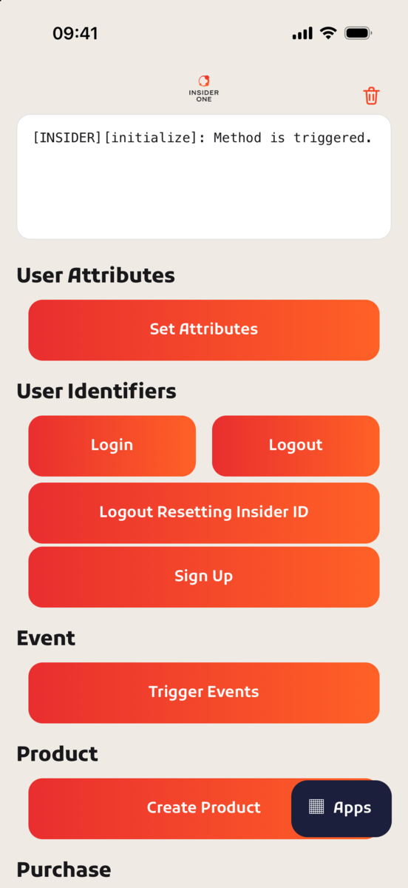
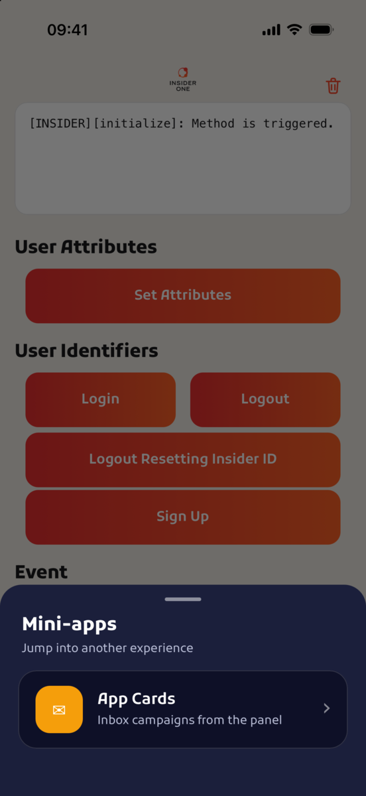
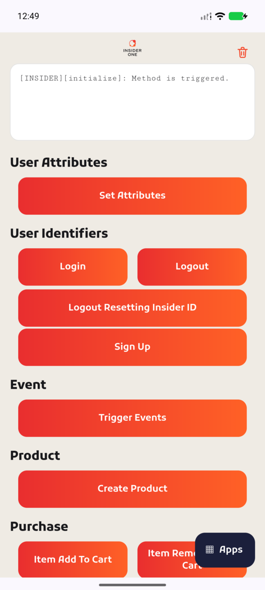
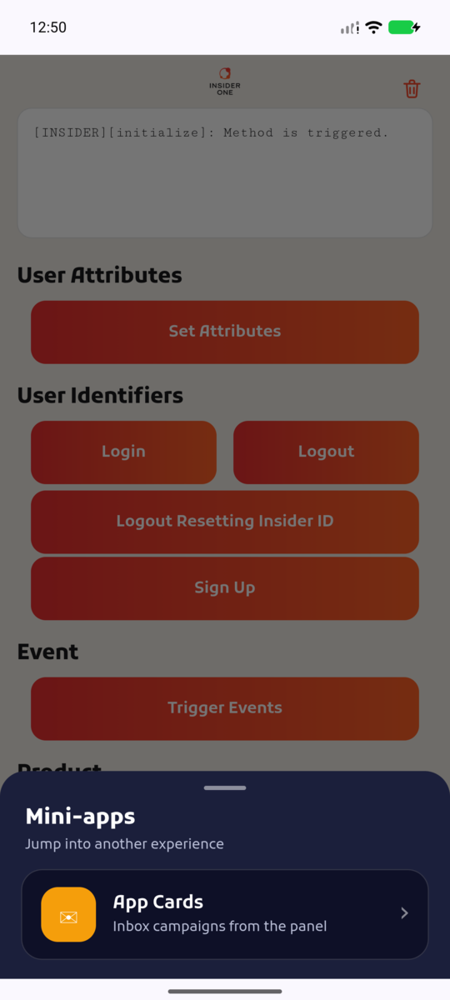

# Insider Cordova SDK Example

[](https://www.npmjs.com/package/cordova-plugin-insider)
[](https://github.com/useinsider/Insider-iOS-SDK)
[](https://mobilesdk.useinsider.com/android/com/useinsider/insider/)

<p align="center">
  
</p>

<p align="center">
  <a href="https://insiderone.com/">Insider</a> &bull;
  <a href="https://academy.insiderone.com/docs/cordova-integration">Documentation</a> &bull;
  <a href="LICENSE">MIT License</a>
</p>

This project demonstrates how to integrate the [Insider Cordova SDK](https://academy.insiderone.com/docs/cordova-integration) (`cordova-plugin-insider`) into a Cordova application for **iOS** and **Android**. It includes a fully working example with an output console for every SDK call, the iOS notification extensions on **Swift Package Manager**, Android push through Firebase Cloud Messaging and Huawei Messaging Service, and an App Cards inbox.

This branch (`with-firebase-packages`) shows the same app in a project that already uses [`cordova-plugin-firebase-messaging`](https://github.com/chemerisuk/cordova-plugin-firebase-messaging) for its own pushes: Firebase asks for the notification permission and owns the FCM token, and pushes sent by Insider are handed to the Insider SDK. See [Firebase Messaging](#firebase-messaging).

## Preview

<table align="center">
  <tr>
    <th colspan="2">iOS</th>
    <th colspan="2">Android</th>
  </tr>
  <tr>
    <td></td>
    <td></td>
    <td></td>
    <td></td>
  </tr>
</table>

- An output console under the logo bar: every button writes the SDK call's result (or error) there, so you can check a call without Xcode or logcat. The trash button in the logo bar clears it.
- One section per SDK area: user attributes and identifiers, events, products, purchases, Smart Recommender, page visits, GDPR, App Cards, Content Optimizer, geofence, in-app messages, wishlist, reinit and more.
- An **Apps** button that opens the mini-apps sheet; **App Cards** opens the App Cards inbox page.

## Requirements

| Requirement | Minimum |
|---|---|
| Node.js | 20.17.0 or 22.9.0+ (CI uses 22) |
| Cordova CLI | 12 |
| cordova-ios | 8.2.0 |
| cordova-android | 15.1.0 |
| cordova-plugin-insider | 4.2.0 |
| cordova-plugin-firebase-messaging | 9.2.0 (Firebase iOS SDK 12.19.1 through SPM, Firebase BoM 34.19.0) |
| iOS | 15.0 (required by InsiderMobile 16.5.1) |
| Xcode | 16.0+ |
| Android | API 24 (compile and target SDK 36) |
| JDK | 17 |
| Gradle | 8.14.2 |

CocoaPods must be installed for iOS: Cordova still runs `pod install` on the Podfile it generates, although no Insider pod is used.

## Project Structure

```
www/                                # The web app Cordova copies into both platforms
├── index.html                      # Home: output console and one section per SDK area
├── app-cards.html                  # App Cards inbox
├── js/index.js                     # Insider.init and every button's SDK call
├── js/app-cards.js                 # App Cards page logic
└── css/                            # Design tokens and page styles
config.xml                          # App identity, icons, iOS deployment target, App Group, URL scheme, hooks
res/icons/                          # App icon sources (iOS light/dark/tinted, Android adaptive)
res/android/                        # InsiderAwareMessagingService.java, copied into the Android project by config.xml
scripts/
├── ios-extension-targets.rb        # Adds the notification extensions and their SPM library to the Xcode project
└── ios-extension-check.js          # after_prepare hook: warns when the extensions are missing
platforms/
├── ios/
│   ├── App.xcworkspace             # Open this in Xcode (target App, product CordovaDemo)
│   ├── InsiderNotificationService/ # Notification Service Extension
│   └── InsiderNotificationContent/ # Notification Content Extension (with InsiderInterface.storyboard)
└── android/                        # Gradle project (applicationId com.useinsider.ecommerce)
test/                               # Jest tests (jsdom) for the web app and the native action names
ci/fixtures/                        # Fake Firebase config used by CI builds
```

The two `platforms/` folders are committed with the project's native changes (signing, entitlements, notification extensions), so they are not regenerated from scratch on every build.

## Getting Started

### 1. Clone the Repository

```bash
git clone https://github.com/useinsider/CordovaDemo.git
cd CordovaDemo
```

### 2. Install Dependencies

```bash
npm install -g cordova@12
npm install
```

`npm install` installs `cordova-ios`, `cordova-android` and `cordova-plugin-insider`. On iOS, Xcode resolves the Insider iOS SDK package on the first build; there is no `pod install` step for Insider.

### 3. Configure Your App

Search the project for `FIXME-INSIDER` to find every value to replace.

| What | Where |
|---|---|
| Partner name | `PARTNER_NAME` at the top of `www/js/index.js` |
| Partner name (Android test device and deep links) | `manifestPlaceholders` → `partner` in `platforms/android/app/build.gradle` |
| Partner name (iOS test device and deep links) | the `insideryourpartnername` URL scheme in `config.xml` → `platform ios` → `CFBundleURLTypes`; replace `yourpartnername` |
| iOS bundle identifier | `widget id` in `config.xml` (default `com.useinsider.demo.external`) |
| Android application ID | `android-packageName` in `config.xml` (default `com.useinsider.ecommerce`) |
| App Group | `group.com.useinsider.mobile-ios`: `initInsider` in `www/js/index.js`, `APP_GROUP` in both extensions, the two extension `.entitlements` files and the `com.apple.security.application-groups` entries in `config.xml` |

Run `cordova prepare` after changing `config.xml`.

#### Android

1. Add `google-services.json` (Firebase) and, for Huawei devices, `agconnect-services.json` to `platforms/android/app`. `google-services.json` must contain a client for the application ID, or the build fails with "No matching client found".
2. Debug builds use the default Android debug keystore. For release builds, add your keystore to `platforms/android/app` and replace `signingConfigs` in `platforms/android/app/build.gradle`.
3. Cordova needs Gradle on your `PATH` (or Android Studio installed) to generate the Gradle wrapper. Set `ANDROID_HOME` and a JDK 17 `JAVA_HOME`.

#### iOS

1. Open `platforms/ios/App.xcworkspace` in Xcode and check the team, App Group and bundle identifier of all three targets (`App`, `InsiderNotificationService`, `InsiderNotificationContent`).
2. Push notifications need the Push Notifications capability (`aps-environment` is already in the app entitlements) and a push certificate or key for your bundle identifier in the Insider panel.
3. Add `GoogleService-Info.plist` for your bundle identifier to the `App` target. The Firebase plugin configures Firebase at launch, and without this file the app crashes on start.

### 4. Run

```bash
cordova run android
cordova run ios
```

If the default simulator is not installed, pick one explicitly: `cordova run ios --emulator --target="iPhone-17"` (list them with `cordova run ios --list`).

## SDK Initialization

The SDK is initialized on `deviceready` in `www/js/index.js`:

```javascript
async function initInsider() {
    await window.Insider.init(PARTNER_NAME, 'group.com.useinsider.mobile-ios',
        (callback) => {
            switch ((callback.result || {}).type) {
                case window.Insider.callbackType.NOTIFICATION_OPEN:
                    logInsider('NOTIFICATION_OPEN', callback.result || {});
                    break;
                case window.Insider.callbackType.SESSION_STARTED:
                    logInsider('SESSION_STARTED', callback.result || {});
                    break;
            }
        },
    );

    window.Insider.startTrackingGeofence();
    if (window.cordova.platformId === 'ios') {
        window.Insider.setActiveForegroundPushView();
    }
    window.Insider.enableLocationCollection(true);
    window.Insider.enableIpCollection(true);
    window.Insider.enableCarrierCollection(true);
}
```

The callback receives the SDK's events in `callback.result`; the demo writes push opens (`NOTIFICATION_OPEN`) and session starts (`SESSION_STARTED`) to the output console.

On this branch the notification permission comes from Firebase (`initFirebase`, see [Firebase Messaging](#firebase-messaging)), so `registerWithQuietPermission` is not called.

### Test Device

Add the app as a test device from the panel with the QR code or the email link. The link opens `insider<partner>://test_device/<token>`, so the partner name must be set in all three places listed in [Configure Your App](#3-configure-your-app).

## Push Notifications

### iOS: Notification Extensions

The SDK uses two notification extensions:

- **Notification Service Extension** (`platforms/ios/InsiderNotificationService`) downloads rich media (images, videos) before the notification is shown.
- **Notification Content Extension** (`platforms/ios/InsiderNotificationContent`) shows the interactive carousel of expanded push notifications.

Both use Swift Package Manager, as the [Cordova Swift Package Manager guide](https://academy.insiderone.com/docs/migrate-cordova-ios-from-cocoapods-to-swift-package-manager) describes:

- The `InsiderMobileAdvancedNotification` library of the [Insider iOS SDK package](https://github.com/useinsider/Insider-iOS-SDK) is added to the **App** target. The extensions link nothing themselves; Xcode embeds the framework in the app, where they find it.
- `InsiderNotificationContent` carries its own copy of `InsiderInterface.storyboard`, with **Inherit Module From Target** checked so that the runtime finds `NotificationViewController`.
- The app and both extensions share the `group.com.useinsider.mobile-ios` App Group.

#### Re-creating the iOS platform

`cordova platform rm ios && cordova platform add ios` re-creates the Xcode project without the extension targets; `cordova prepare` then warns that they are missing. To add them back:

```bash
git checkout -- platforms/ios/InsiderNotificationService platforms/ios/InsiderNotificationContent
ruby scripts/ios-extension-targets.rb
cordova prepare ios
```

The script adds both extension targets, the `InsiderMobileAdvancedNotification` library on the app target and the storyboard. It is safe to run again on an existing project. Re-apply the other native changes of `platforms/ios` (app delegate, Info.plist keys, signing) from git as well.

### Android: Firebase Cloud Messaging and Huawei Messaging Service

`cordova-plugin-insider` adds the Firebase Messaging and HMS dependencies, and the Insider Android SDK registers its own `InsiderFirebaseMessagingService` and `InsiderHuaweiMessagingService`, so the app needs no messaging service of its own. The plugin enables the Google Services Gradle plugin, which reads `google-services.json` at build time, and its install hook adds the Huawei AGConnect Gradle plugin for `agconnect-services.json`.

On this branch the Firebase plugin asks for `POST_NOTIFICATIONS` (Android 13+). Grant location (for geofence tracking) in the app's system settings before testing geofences.

## Firebase Messaging

`initFirebase()` in `www/js/index.js` runs on `deviceready`, after `initInsider()`:

```javascript
function initFirebase() {
    const messaging = window.cordova.plugins.firebase.messaging;
    messaging.requestPermission({ forceShow: true })
        .then(() => logFirebase('requestPermission', 'granted'))
        .catch((error) => logFirebase('requestPermission', error));
    messaging.getToken()
        .then((token) => logFirebase('getToken', token))
        .catch((error) => logFirebase('getToken', error));
    messaging.onMessage((payload) => forwardInsiderPush('onMessage', payload));
    messaging.onBackgroundMessage((payload) => forwardInsiderPush('onBackgroundMessage', payload));
}
```

`forwardInsiderPush` writes every push to the output console as `[FCM][...]` and passes the ones whose `source` is `Insider` to `Insider.handleNotification`.

### Android: InsiderAwareMessagingService

Android hands an FCM message to **one** messaging service only. The app now has three: the Firebase plugin's `FirebaseMessagingPluginService`, the Insider SDK's `InsiderFirebaseMessagingService` and Firebase's own fallback. The plugin passes messages to JS only while the WebView is alive, so on its own an Insider push sent to a closed app would be lost.

`res/android/InsiderAwareMessagingService.java` extends the plugin's service and is registered with intent filter priority `1`, so Android picks it over the others:

- Insider pushes (`source` is `Insider`) go straight to `Insider.Instance.handleFCMNotification`, in the foreground, in the background and when the app is closed. They do not reach the JS listeners.
- Other pushes go to the Firebase plugin unchanged.
- New tokens go to both the plugin and `Insider.Instance.setPushToken`.

`config.xml` copies the class into the Android project (`<resource-file>`) and adds the service to the manifest (`<config-file>`), so both survive `cordova platform rm/add android`. It also keeps the Google Services Gradle plugin at 4.4.2, the version `cordova-plugin-insider` asks for (the Firebase plugin asks for 4.4.0).

### iOS

The JS listeners forward Insider pushes to `Insider.handleNotification`. The iOS side of this branch has been built but not run: running it needs a `GoogleService-Info.plist` (see [iOS](#ios)).

## Testing

```bash
npm test
```

Jest runs the web app in jsdom with a faked `cordova.exec`, and a native action test checks that every action name the JS calls exists in the plugin's Android and iOS sources. The **Tests** workflow (`.github/workflows/run-tests.yml`) runs these unit tests and builds both platforms on pull requests and pushes to `main`.

## License

This project is licensed under the MIT License. See the [LICENSE](LICENSE) file for details. The Apache Cordova platform code that Cordova copies into `platforms/` (for example `platforms/android/CordovaLib` and `platforms/ios/packages/cordova-ios`) keeps its own Apache License 2.0 notices.
